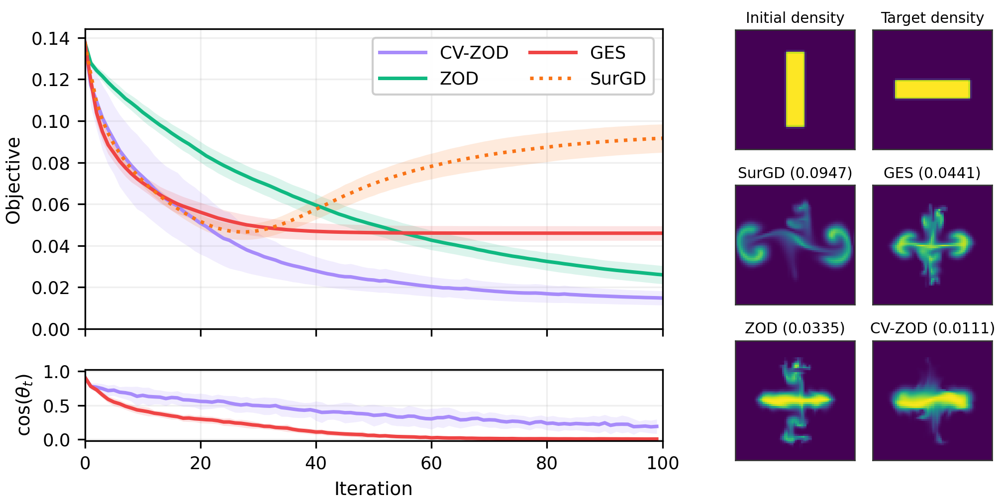
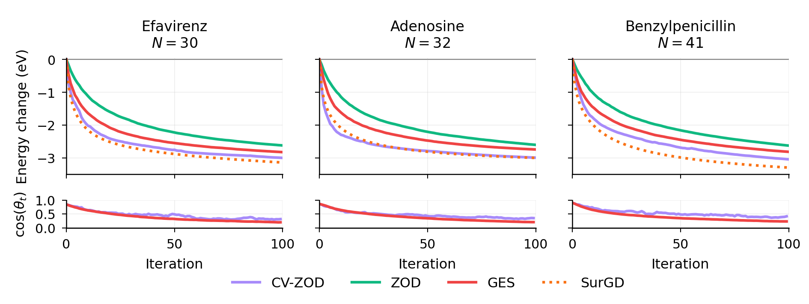
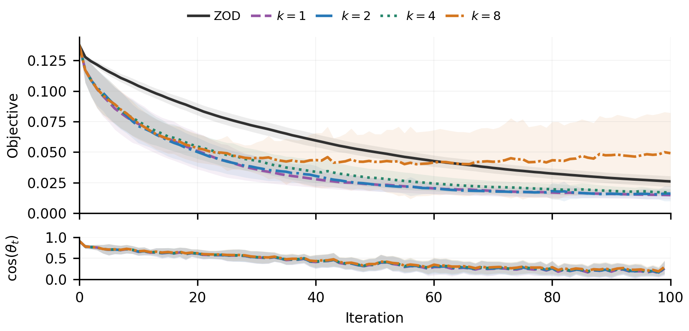

# Control-Variate Zeroth-Order Descent ([arXiv](https://arxiv.org/abs/2609.08277))

Code for **Adaptively Incorporating Directional Hints into Zeroth-Order Optimization**.

Run the fluid dynamics and molecular conformations experiments with the paper
settings or choose your own run lengths, query budgets, and optimization settings.

Run all commands below from the directory containing this README.

## Setup

Use Python 3.9-3.12 and a C++17 compiler on macOS or Linux.

```bash
python3 -m venv .venv
.venv/bin/python -m pip install -r requirements.txt
```

## Run custom experiments

Use `fluid` or `molecules` to select the experiment. For example:

```bash
.venv/bin/python run.py fluid --steps 200 --seeds 5 \
    --query-budget 32 --discount 0.8 --output results/custom_fluid
```

| Option | Use |
| --- | --- |
| `--steps` | Optimization steps per run |
| `--seeds` | Number of paired fluid runs, including a single run |
| `--conformations` | Number of starting conformations per molecule, from 1 to 10 |
| `--query-budget` | Queries per zeroth-order update, including the current value |
| `--norm-queries` | Queries allocated to the CV-ZOD norm estimates |
| `--discount` | Discount factor, from 0 up to but excluding 1 |
| `--hint-dim` | Hint space dimension k; accepts a list and defaults to 1 |
| `--radius` | Finite-difference radius |

Use a separate `--output` directory when changing settings other than `--hint-dim`.
Values of `k` and norm queries must fit the query budget. Run `.venv/bin/python run.py --help`
to see all options and their defaults.

## Reproduce the paper figures

### Figure 2: Fluid inverse problem

```bash
.venv/bin/python run.py fluid --workers 4
```



### Figure 3: Molecular geometry optimization

```bash
.venv/bin/python run.py molecules --workers 4
```



### Figure 4: Effect of hint space dimension

```bash
.venv/bin/python run.py fluid --workers 4 --hint-dim 1 2 4 8
```



By default, Figures 2 and 4 use 20 paired runs, and Figure 3 uses 10 starting
conformations per molecule. Each run has 100 optimization steps.
Figure 3 downloads its model automatically on the first run.

Results are saved under `results/`. Rerun the same command to reuse completed
runs and finish interrupted work. Figures 2 and 4 reuse their shared runs.
Adjust `--workers` to change parallelism, or use `--output PATH` to choose
another output directory.

## Plot results

Each command generates its plots automatically after the experiment finishes.
The fluid command generates Figure 2 for one hint dimension and Figure 4
when comparing multiple hint dimensions. The molecules command generates Figure 3.
Rerun the corresponding figure command to regenerate plots from completed runs.
To plot saved results without starting any experiments:

```bash
.venv/bin/python run.py fluid --plot-only --output results/custom_fluid
```

`--plot-only` uses the settings saved with the results.
PDF plots are saved as:

```text
results/figure2.pdf
results/figure3.pdf
results/figure4.pdf
```

Figure 4 also saves the angles at every iteration in `results/figure4_angles.csv`.
Its alignment curves use the trajectory with the largest requested `k`;
the CSV also includes alignment along each run's own trajectory.

## Project organization

```text
run.py                  Run an experiment and generate its plots
requirements.txt        Python dependencies
THIRD_PARTY_LICENSES.txt Third-party license and attribution
cvzod/                  Experiment code
assets/                 Figure previews shown in this README
results/                Saved runs and generated plots
```
